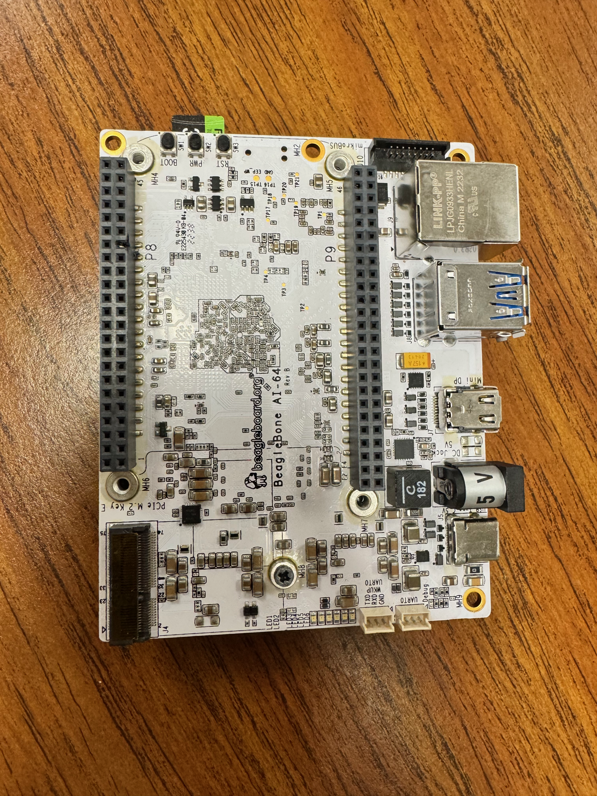
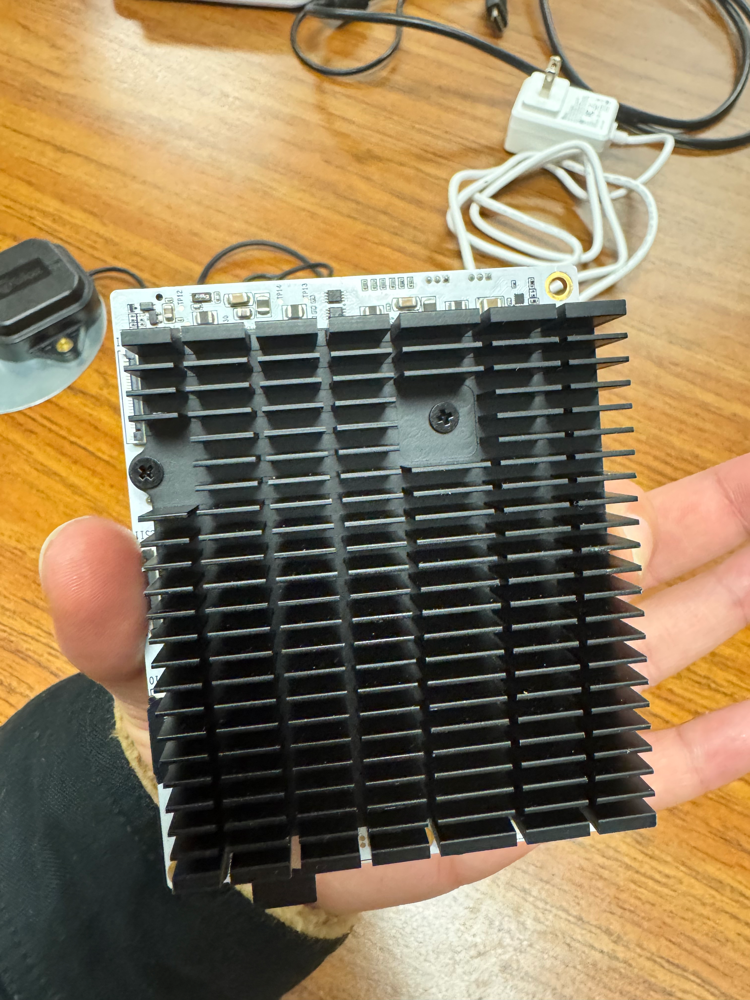
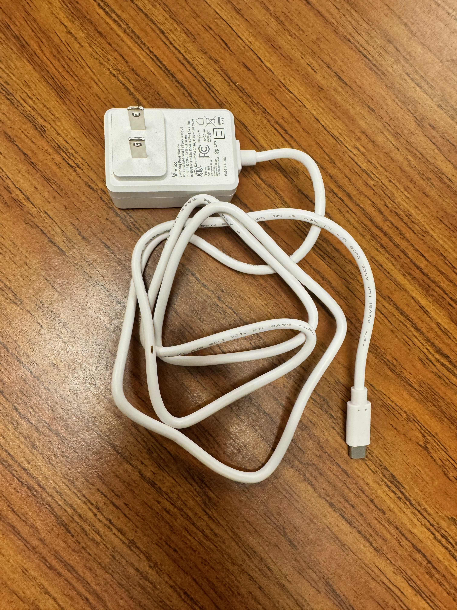
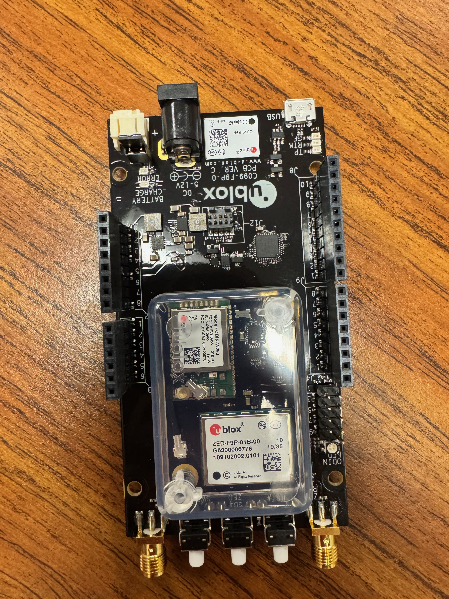
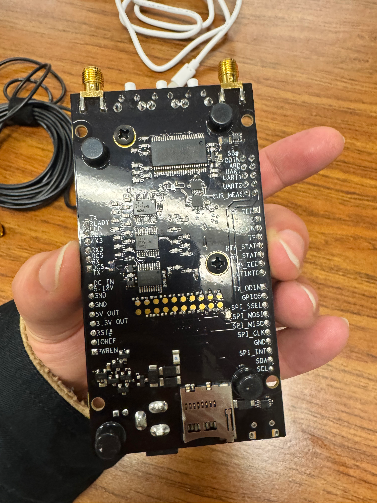
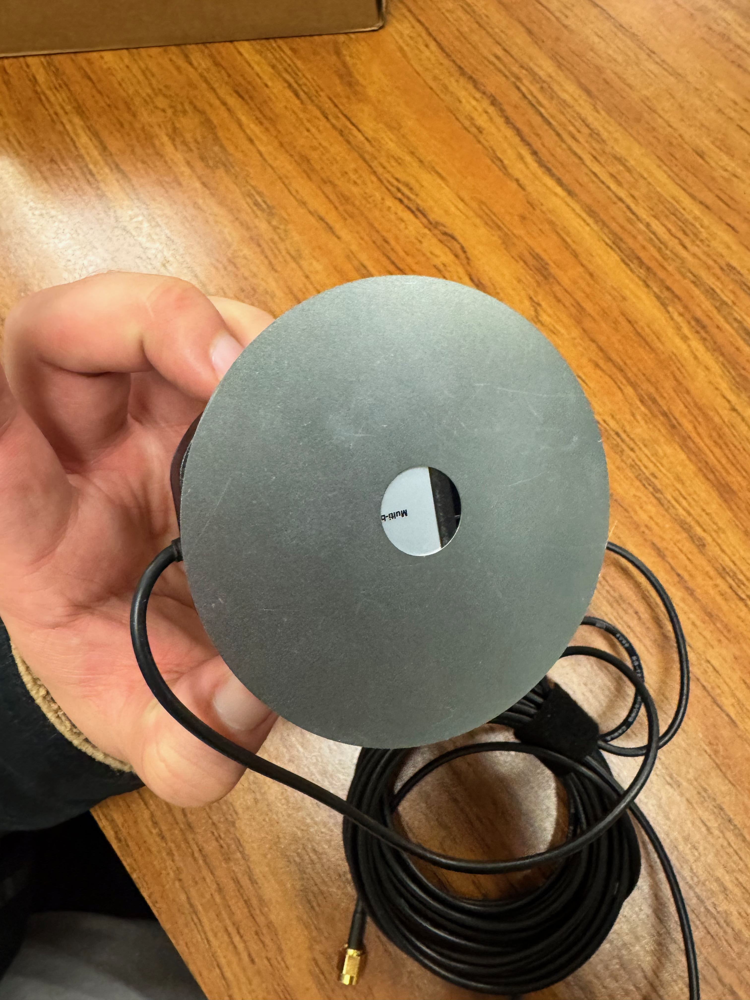

# Odometer Labs: GPS-Carputer
## Current Harware Inventory

# BeagleBone AI-64

*Top Side*

*Bottom Side*

*This is a BeagleBone AI-64. This baby has 16 cylinders, 800 horsepower and it makes a pretty darn good latte. Just kidding. It is a pretty beefy single-board computer (SBC) designed specifically for machine learning and computer vision at the edge, though. It’s a significant step up from the classic BeagleBone Black, trading the compact "pocket" size for a lot more processing power.*

*Key Features:
Processor: It runs on the Texas Instruments TDA4VM SoC, which includes dual Arm Cortex-A72 cores and dedicated hardware accelerators for AI (DSP and deep learning engines).*

*Expansion: You can see the signature dual 46-pin headers (P8 and P9), maintaining some compatibility with BeagleBone "Capes."*

*Connectivity:*

*Gigabit Ethernet (top right).*

*Dual USB 3.0 Type-A ports (blue).*

*Mini DisplayPort for video output.*

*USB Type-C for power and data.*

*M.2 E-key slot (bottom left) usually used for adding Wi-Fi/Bluetooth cards.*
*Here are the relevant BeagleBone Docs:*

*BeagleBone AI-64*

[BeagleBone AI-64 Documentation](https://docs.beagleboard.org/boards/beaglebone/ai-64/index.html)

*Quick Start*

[BeagleBone AI-64 Quick Start Docs](https://docs.beagleboard.org/boards/beaglebone/ai-64/02-quick-start.html)

*Latest BeagleBone Images:*

[Latest Distro Images](https://www.beagleboard.org/distros)

*(White Power Brick): This is a USB-C Power Adapter (Vemico brand). It provides the necessary power for the BeagleBone AI-64, which requires a 5V supply at a minimum of 3A (15W) to operate reliably.*

*(Multi-ended Black Cable): This is a specialized Active Mini DisplayPort (miniDP) to HDMI Adapter Cable.*

*MiniDP end: Connects to the video output of the BeagleBone AI-64.*

*HDMI end: Connects to the monitor.*

*USB-A end (pigtail): This provides the extra power required for the internal conversion chip that translates the DisplayPort signal to HDMI. The BeagleBone AI-64 specifically requires an active adapter; a standard passive cable will not work.*

# U-blox C099-F9P Application Board

Top Side

Bottom Side

*This U-blox C099-F9P Application Board, is our ultra-super-duper precise GPS module*

*These are the various docs that pertain to the GPS module:*

*U-blox C099-F9P Application Board*

[U-blox C099-F9P Application Board](https://www.u-blox.com/en/product/c099-f9p-application-board)

*U-blox C099-F9P User Guide*

[C099-F9P User Guide](https://content.u-blox.com/sites/default/files/C099-F9P-AppBoard-ODIN-W2-uCX_UserGuide_(UBX-18055649).pdf)

*ZED-F9P integration manual*

[ZED-F9P integration manual for High Precision GNSS module](https://content.u-blox.com/sites/default/files/ZED-F9P_IntegrationManual_UBX-18010802.pdf)

*This is potentially useful software from the manufacturer that is used to visualize GPS data*

[u-center GPS visualizer, windows only](https://www.u-blox.com/en/product/u-center)

*(Black Power Brick): This is a DC Barrel Jack Power Adapter (standard 2.1mm plug). In your setup, this is used for the u-blox C099-F9P board, which can be powered by an external 6V–12V DC source through its power jack.*

# GNSS antenna component

*Top Side*

*Bottom Side*
*This is the ground plane with the antenna component, see above documentation for integration manual*

# APRS 

*under construction, nobody here but us chickens... Where in the world is Kevin San Diego?*

