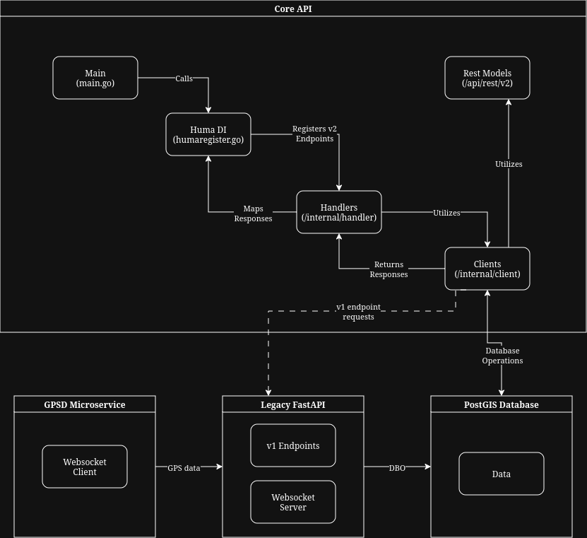

# Core API
This project is the Core API Project, which aims to facilitate communications across all teams and components in the Carputer project.

## Description
The Core API project aims to replace the old, legacy FastAPI service we built during early development. With the concerns of concurrency, speed, efficiency, and limitations of Python and Starlette, especially on our Raspberry Pi, we decided to re-write the entire Rest Backend using the Go language, utililizing [Huma](https://huma.rocks/) and [PGX](https://pkg.go.dev/github.com/jackc/pgx/v5).  

To get an idea as to how much of an upgrade this is, take a look at these benchmarks from https://www.techempower.com/benchmarks
  

The top 5 fastest frameworks (fiber, chi, aah, gin, and kami) are all written in Go! And the Huma framework acts as a guice for for these frameworks. It absolutely blasts FastAPI out of the water.

## What the Core API does not cover
**The Core API service purely covers the REST endpoints and does not serve a websocket server or cover websocket-specific endpoints**. So real-time position and Smart Beaconing algorithms are still used in the legacy FastAPI service. 

## New Available Endpoints
 
### Root
 
| Method | Path | Summary |
|--------|------|---------|
| `GET` | `/v2/root` | Prints Hello World! |
 
---
 
### Position
 
| Method | Path | Summary |
|--------|------|---------|
| `GET` | `/v2/position` | Get the current position from gpsd |
 
---
 
### Tracks
 
| Method | Path | Summary |
|--------|------|---------|
| `POST` | `/v2/tracks` | Create and start a new track recording |
| `GET` | `/v2/tracks` | End the current track recording |
| `POST` | `/v2/tracks/track-point` | Add a track point to the current track |
| `GET` | `/v2/tracks/list-tracks` | List all tracks |
| `GET` | `/v2/tracks/{track_id}` | Get a track by ID |
| `PUT` | `/v2/tracks/{track_id}` | Update a track's metadata (start_time, end_time, track_name) |
| `DELETE` | `/v2/tracks/{track_id}` | Delete a track by ID |
| `POST` | `/v2/tracks/tracks-mvt/{track_id}` | Get MVT data for a track |
| `POST` | `/v2/tracks/import-track` | Import a track |
| `POST` | `/v2/tracks/import-track-point/{track_id}` | Import a track point to a specified track |
| `GET` | `/v2/tracks/check-new-road` | Check if currently on a new road |
 
---
 
### APRS
 
| Method | Path | Summary |
|--------|------|---------|
| `POST` | `/v2/aprs/ingest` | Ingest an APRS packet |
| `POST` | `/v2/aprs/ingest/raw-aprs` | Ingest a raw APRS packet |
| `POST` | `/v2/aprs/stations` | Get nearby APRS stations (default search radius: 500,000 km) |
| `POST` | `/v2/aprs/station` | Get a specific APRS station |
| `POST` | `/v2/aprs/station/history` | Get an APRS station's history |
| `POST` | `/v2/aprs/station/cleanup` | Clean up old APRS data by time range |

---

### Versioning 
| Method | Path | Summary |
|--------|------|---------|
| `POST` | `/versioning` | Create New Version |
| `GET`  | `/versioning/latest` | Get Latest Version |
| `GET`  | `/versioning/history` | Get Version History |

---

### Travel History
| Method | Path | Summary |
|--------|------|---------|
| `POST` | `/travel/history` | Create Travel History |
| `GET`  | `/travel/history` | List Travel History |

---


## Requirements 
- Go version 1.26+

## Development Environment Setup
Navigate to the root of the project  
`$ cd core-api`  

Install dependencies  
`$ go mod tidy`  

That's it! You're ready to develop!

## Running Locally
Ensure your current working directory is in the project's root
```
$ pwd
/home/user/.../repo/carputer/core-api
```

Run the go command  
`$ go run cmd/app/main.go`

That's it! You can visit http://localhost:8888/docs to see all the endpoints we got!

## Contribution Guide

### Huma Framework
We use the Huma framework to develop the REST backend. Visit https://huma.rocks/ for documentations. When implementing new endpoints, be sure to follow the [Operations Guide](https://huma.rocks/features/operations/) for best practices when naming endpoints.

### Project Structure
Unlike the previous FastAPI service, we aim to apply industry practices and guidelines in this project. We structured this Go project close to what production-ready Go projects and packages follow.
```
.
└── core-api/
    ├── api/
    │   └── rest/
    │       ├── v1/
    │       └── v2/
    ├── cmd/
    │   └── app/
    │       └── main.go
    ├── deployments/
    │   └── docker/
    │       ├── Dockerfile
    │       └── .dockerignore
    ├── internal/
    │   ├── client/
    │   ├── handler/
    │   └── postgis/
    ├── configs/
    │   └── .env.example
    ├── pkg
    ├── go.mod
    ├── go.sum
    ├── .env
    ├── .gitignore
    └── README.md
```
<small>Created with this awesome site: https://tree.nathanfriend.com/</small>

### `/cmd`

This is where your **entry points** live. Each subdirectory under `cmd` represents a separate executable binary.


### `/internal`

This is a special directory in Go. Code inside `/internal` can only be imported by packages within the same parent tree.


### `/pkg`

Unlike `internal`, code in `/pkg` is **public** and can be imported by anyone. This really is only useful if say another go project is importing our project.

**Note:** Since our Core API is a closed-ecosystem with other carputer services, we might not need this at all.

### `/api`

This folder holds your API contract definitions.

**Examples:** OpenAPI/Swagger specs, JSON schema files, DTOs and Rest Models, etc.

### `/configs`

Configuration file templates or default settings (e.g., `config.yaml`, `.env.example`).

### `/deployments`

This folder contains any deployment specific files. For example: Dockerfile, CI/CD yaml, deploment configs, etc.

## Overall Backend Architecture
To help understand the codebase and it's overall integration with other services, check the diagram below.  


